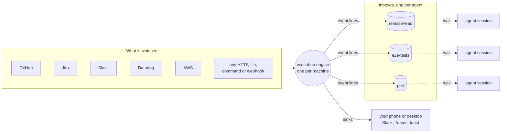

# watchhub

**One engine per machine watches your world. Every agent gets an inbox and sleeps until something it asked for happens.**

## The problem it solves

AI coding agents spend a lot of their time waiting: for a pull request to merge, for CI to finish, for a deploy to land, for a ticket to move, for someone to answer on Slack. Each time an agent checks, it spends a turn, and every turn is a full context load. Ten agents each polling five things every minute is a quiet fortune in tokens, most of it to learn that nothing happened.

watchhub turns that round. One small engine runs on the machine and does all the watching. Each agent tells it once what it cares about, then blocks on a command that only returns when there is news. No polling loops, no turns spent on no-news, and the agent reads a short burst of plain lines with its instructions attached.

## How it works



1. **Sources** are polled or streamed by the engine: pull requests, checks, tickets, messages, metrics, a log file, a queue, anything a command or an HTTP call can see.
2. Each change becomes one **event line**: `2026-10-15T21:53:40Z | pr-checks | team | CHECKS webapp#42 1a2b3c4 all green`.
3. An agent **subscribes** once, naming an inbox and what it wants (a filter, or a plan with instructions per kind of event).
4. The agent runs `watchhub wait <inbox>` in the background. The command returns only when a matching line lands, prints the burst with the plan's instructions, and exits. That exit is the wake-up.
5. Lines a person should see go to **sinks** as well: Slack, Teams, a desktop notification, any webhook.

Everything is a plain file in one folder: the event log, the inboxes, the subscriptions, the plans. Any tool can read them.

## Five-minute setup

Needs Node 20 or newer. Windows, Linux and macOS.

```bash
git clone https://github.com/mrd1234/watchhub && cd watchhub && npm link
watchhub init ~/watch          # an instance folder with a starter instance.json
watchhub home                  # ~/.watchhub: an env file for tokens, config.json with the default instance
```

Put tokens in `~/.watchhub/env` as `KEY=value` lines (`GITHUB_TOKEN`, `JIRA_API_TOKEN`, `SLACK_USER_TOKEN`, `DD_PAT`, `JENKINS_USER` and `JENKINS_TOKEN`, `SONAR_TOKEN`). Fill in the sections of `instance.json` for the modules you want (see `example/instance.json`), then:

```bash
watchhub doctor                # every token, host and file checked, in plain words
watchhub service install       # the engine as a service that survives logoffs and reboots
```

To update, in the clone: `git fetch origin && git reset --hard origin/main`, then `watchhub restart`. Each release replaces `main` with a single commit carrying the whole tree and its version in `package.json`, so the public history holds nothing but the current release; a plain `git pull` refuses to cross that, which is why the reset (local edits in the clone are not kept: keep yours on a branch). The running engine records its version in `state.json` (`_engine.version`), so a display can say when it is behind. Maintainers release with `npm run release -- [patch|minor|major] --gh-user <login>`: it runs the tests, checks every file against the deny list (`.git/info/deny-words`, one regex of words that must never be published, kept out of the repository), bumps the version, and pushes the snapshot as main's one commit, in one step.

## Everyday use, as an agent

```bash
watchhub sub release-lead --plan release --ttl 24h      # once
watchhub wait release-lead                              # in the background; returns on news
```

What the wait prints when it returns:

```text
2026-10-15T21:50:55Z | pr-checks | team | CHECKS webapp#42 1a2b3c4 all green
2026-10-15T21:53:44Z | jobs | all | JOB deploy-gate FAILURE

INSTRUCTIONS
- if the PR has passed the drill, add it to the ready block
- read the failing check, fix the flagged lines, re-push
Tell the user in one line what arrived and what you are doing.

ALSO (low priority, 3 lines since the last burst; full text: watchhub events --inbox release-lead)
- custom:slack-inbox: 2 lines; last: #team Dev: can you look at the stamp | #eng Dev: ticket is on staging
- notice: 1; restart at 21:35, nothing lost
```

Lines above INSTRUCTIONS are what woke the agent. INSTRUCTIONS come from the plan, once per matching rule. ALSO is metadata: low-priority lines that arrived meanwhile, grouped and counted, which never cost a wake on their own.

A one-off wait needs no plan:

```bash
watchhub wait e2e --filter 'webapp#42|JOB deploy-' --ttl 4h --once
```

## No wait command at all: hooks

With Claude Code, two hooks remove the last manual step. Install them into a project once:

```bash
watchhub hook install ~/my-project      # two hooks in .claude/settings.json, the skill in .claude/skills/watchhub
```

From then on every session in that project is told its inbox when it starts (one line of context), and when the agent ends a turn the Stop hook holds the turn open until a burst lands and hands the burst back as the agent's next input. The agent subscribes once with `watchhub sub <inbox> --label '<what it waits on>' --plan <plan>` and never arms anything; the label is what people see beside the `s-…` name in `watchhub subs`. A session with no subscription is not held and costs nothing. A `.watchhub.json` in the project (`{"plan": "release"}` or a filter) subscribes every session automatically.

Install into your home directory (`watchhub hook install ~`) and the hooks cover every project on the machine. Remove any project-level copy at the same time. Claude Code runs an exact duplicate once, but a copy that differs (an older command, another hold time) can run as a second hook.

Installing works on a session that is already running, since Claude Code picks up the new hooks. That session never ran the start hook, though, so it was neither told its inbox nor subscribed from `.watchhub.json`. It works out its own inbox, which is the `inbox` in `.watchhub.json` if there is one and otherwise `s-` followed by the first ten letters and digits of its session id, lowercased (a session id `109fea53-cef6-…` gives `s-109fea53ce`). Then it subscribes with `watchhub sub`, and from then on the Stop hook holds at each turn end.

The agent learns all of this from a skill that `hook install` writes next to the hooks, in `<dir>/.claude/skills/watchhub/SKILL.md`. It is the how-to that ships with the package (`skills/watchhub/SKILL.md`) followed by a section generated from your instance: its sources, watches, scopes, plans and sinks, and the team's own rules from `agentNotes` in `instance.json` (a string or a list of them, such as who to tell about a burst or which inbox each lane uses). The engine rewrites the skill whenever the instance changes and after an upgrade, so it never goes stale and nobody copies it by hand. It is generated per machine, so keep a project-level copy out of git (`.claude/skills/watchhub/` in `.gitignore`); with no instance yet, `hook install` writes the hooks and asks for `watchhub init` first. For an agent that reads skills from somewhere else, `watchhub skill --out <its skills folder>/watchhub` writes and keeps a copy there, and `watchhub skill` prints it.

## Wake me later: at and in

A session that needs to look at something later, or wants a person told at a set time, asks the engine for one line at that time:

```bash
watchhub in 20m 'check the deploy'              # to this session's inbox; the Stop hook holds the turn for it
watchhub at 15:30 ops 'stand-up notes'           # to another inbox
watchhub at 02:00 --sink slack 'nightly sweep starts'   # to a person, through a sink
watchhub schedules                               # what is pending; unschedule <id> cancels one
```

The line arrives as `SCHEDULED <id> <text>` and wakes the inbox at once. A schedule missed while the engine was down fires when it comes back, marked late; one is never lost. Anything that repeats is a timer watch.

## What it can watch: anything

The engine does not know what it is watching. It runs **sources** and turns what they return into event lines; where the sources look is up to you. Three ways to add one, from no code to a few lines:

1. **A JSON watch**, no code. Point one of the generic kinds at the thing: an HTTP endpoint (a value that changes, a number past a threshold, new items in a list), a file, a command's output, a TCP port, a timer, a long-running command's lines (a queue consumer, a log tail, `docker events`), a webhook that something POSTs to, a Slack channel. One file in `watches/`, live the moment it is saved:

   ```bash
   watchhub watch add '{"name":"staging-version","http":{"url":"https://staging.example.com/version"},"value":"commit"}'
   watchhub watch add '{"name":"errors","file":{"path":"C:/logs/app.log","match":"ERROR|FATAL"}}'
   ```

2. **A module**, a few lines of JavaScript, when a source needs logic (a login flow, two calls joined, a custom comparison). `watchhub module new my-source` writes a working file into `modules/` with the one function to fill in; the engine hands it the state it kept last time and the same helpers the shipped modules use (fetch with ETags, a CLI runner, the change-detection layer). Restart the engine and it runs. `--two-way` makes one that can also answer where it reads (a chat, an inbox): its lines carry a reply handle, and nothing is sent except by `watchhub reply`.

3. **The shipped modules**, switched on by a section in `instance.json`, for the sources most teams share:

| Section | Lines you get |
|---|---|
| `github` | `MERGED repo#1 sha title`, `CHECKS repo#1 sha all green / FAIL: names`, `REVIEW repo#1 approved by who` |
| `jira` | `TICKET NEW key summary`, `TICKET MOVED key from -> to by who`, `TICKET COMMENT key by who: text`; `watchhub jira follow KEY` adds a ticket from outside your projects for 30 days (checked with Jira when `jira.base` is set: a key it does not know is refused) |
| `datadog` | `MONITOR name [host] Alert / OK`, `METRIC name above 85: 91`, `LOGS name 23+ in 5m` |
| `system` | `SYSTEM disk-c below 10: 8.2`, `SYSTEM memory above 90: 93`, `SYSTEM cpu above 90: 97` and `back` (this machine, no token) |
| `jenkins` | `BUILD folder/job #812 FAILURE` when a build ends |
| `sonar` | `SONAR key@main gate OK -> ERROR`, `SONAR key#7 gate ERROR: title` (SonarCloud or SonarQube) |
| `deploys` | `DEPLOY pipeline 1a2b3c4d SUCCEEDED / FAILED` (CodePipeline), `DEPLOY web job 42 SUCCEEDED` (Amplify) |
| `aws` | `AWS profile ok / expired` |
| `vpn` | `VPN office / cloud / none` (any check that only works from one side) |
| `stamps` | `STAMP env api version` when a deployed build changes |
| `slack` | `SLACK DM who: text`, `SLACK #channel who: text`, each with a reply handle: `watchhub reply <handle> 'text'` answers as you in the same thread or DM |
| `jobs.json` | `JOB label SUCCEEDED / FAILED` for a CI run or deploy you queued with `watchhub add-job` |

GitLab, Azure DevOps and Bitbucket need no module: they are HTTP watches, and `example/watches/` has one of each. A module you write for your own provider is the same shape as the shipped GitHub one, and a module in `modules/` with a shipped module's name replaces it.

## Keeping the cost down

- **Priorities.** A plan rule is urgent (wakes at once), normal (wakes after a short settle) or low (rides along in the next burst's ALSO block). Mentions low, direct messages urgent.
- **Cooldown.** After a burst, normal lines wait a minute before the next wake, so a check verdict and the job result that follows it are one wake. Urgent never waits.
- **Instructions as codes.** `watchhub plan skill <plan> --out <your agent's skills folder>/watchhub-plan-<plan>` writes the plan's rules as a skill with a code per rule; the agent loads it once and every burst then ends with `INSTRUCTIONS: MRG, D` instead of the text. Without a skill, a rule's text is printed in full once every few hours per inbox, then named.
- **Derived events.** A spike (more than N lines in a window) or a silence (nothing for too long) is one line, computed by the engine, no model involved. Thresholds on numbers work the same way.
- **Metrics without wakes.** A watch can also keep its number for a display: a `metric` block (unit, and a `display` such as dial, gauge, line or `custom:<name>`) puts the latest value and a day's history in `metrics.json`, tagged with the inboxes that care. A display reads it; no agent wakes for it. See *Drawing metrics* below.
- **Silent restarts.** A restart writes no event; a source's first poll after a start never repeats a line the log already holds.

`watchhub stats` shows wakes per inbox so you can see what each agent is costing.

## Drawing metrics

The engine only records metrics; drawing them is the display's job. The watchhub tray app (watchhub-tray) draws each metric as its `display.type` asks: `dial`, `ring`, `gauge`, `line`, `bar`, `number` or `status`.

To add a display type of your own:

1. In the tray app, copy `src/ui/viz/custom/example.js` (it draws a battery) to `src/ui/viz/custom/<name>.js`. The name is lowercase letters, digits and dashes, starting with a letter.
2. Change its `render(ctx)` to draw what you want and return the element. `ctx` carries the value, unit, label, the day's history, the display block, the warn or bad band and a few drawing helpers; `src/ui/viz/index.js` lists them all.
3. Give the metric `"display": {"type": "custom:<name>"}`. Any extra fields you put in `display` (the battery reads `cells`) reach the renderer untouched.
4. Rebuild the tray app. A renderer that is missing or fails draws the value as a plain number, and the tile says why.

Any other display can read `metrics.json` the same way; its shape is in [docs/reference.md](docs/reference.md#metrics-for-displays).

## Where to go next

- [docs/reference.md](docs/reference.md): every command, kind, module, plan field and file, with the design notes.
- [example/](example/): a full `instance.json`, watches for GitLab, Azure DevOps, Bitbucket, a queue, a webhook, Slack and Datadog, a plan, sinks for Slack, Teams and a desktop notification.
- `watchhub doctor` whenever something looks wrong: it says what is missing in plain words.

MIT licence. Built by a developer who got tired of watching agents watch.
